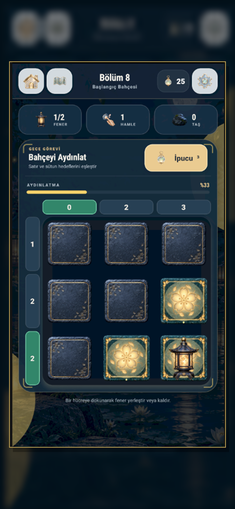
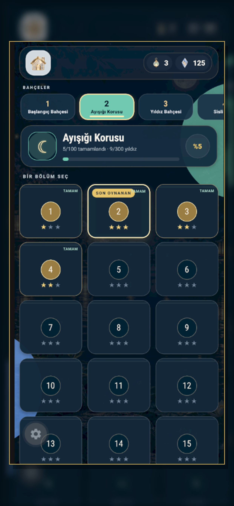
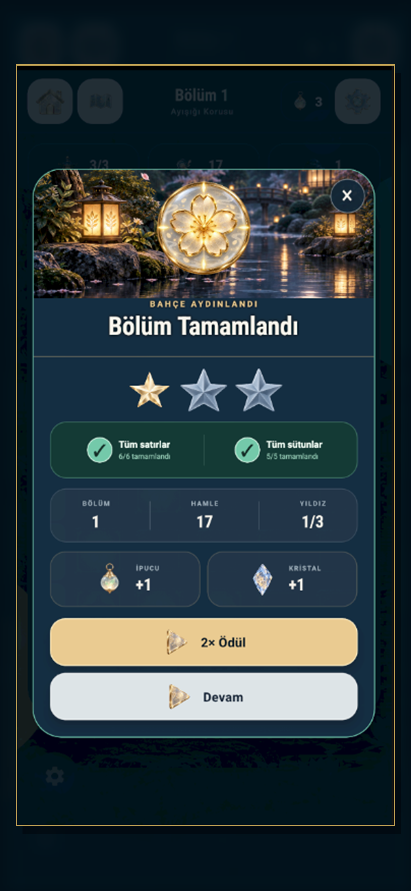

<div align="center">
  
  <h1>Liva Lights</h1>
  <p><strong>A moonlit mobile logic puzzle built with React Native and Expo.</strong></p>
  <p>
    
    
    
    <a href="https://github.com/gogosenl/liva-lights/actions/workflows/ci.yml"></a>
  </p>
</div>

Liva Lights is a polished, portrait-first puzzle game in which players place lanterns to match the illumination clues around a garden board. It combines deterministic puzzle generation, progressive difficulty, persistent progression, native-feeling motion and a custom visual/audio identity.

> This public repository is presented as a portfolio project. Original code, artwork, branding and game design remain all rights reserved; see [LICENSE](LICENSE).

## Screenshots

<table>
  <tr>
    <td align="center"></td>
    <td align="center"></td>
    <td align="center"></td>
  </tr>
  <tr>
    <td align="center"><strong>Responsive puzzle board</strong></td>
    <td align="center"><strong>10 themed gardens</strong></td>
    <td align="center"><strong>Reward and star flow</strong></td>
  </tr>
</table>

## Highlights

- **1,000 deterministic and solvable levels** generated from seeded rules.
- **Progressive onboarding:** a small set of 3×3 and 4×4 boards introduces the mechanic before larger 5×5–7×7 challenges.
- **Six board silhouettes:** full, notched, L-shaped, cross, diamond and terrace layouts.
- **10 garden chapters** with 100 levels each and a progression economy validated by automated tests.
- **Adaptive mobile UI** designed for iPhone, iPad and Android portrait screens.
- **Polished feedback:** screen transitions, lantern placement/removal effects, completion choreography, haptics, music and contextual sound effects.
- **Turkish and English UI**, including tutorial and game-state copy.
- **Persistent local progress** with schema-aware migration through AsyncStorage.
- **Native advertising flow** with consent handling, an ad-free onboarding period and rewarded 2× completion rewards.

## How the puzzle works

Each lantern illuminates its own cell and its orthogonal neighbours. The numbers along the top and left edges describe the required illuminated-cell count for every column and row. Rocks and non-rectangular board silhouettes introduce spatial constraints. A level is complete only when every row and column matches its target while using the required number of lanterns.

The level generator derives each target from a seeded hidden solution. `scripts/levels-test.mjs` independently validates all 1,000 generated puzzles, while `scripts/economy-test.mjs` verifies that every garden can be unlocked without a purchase.

## Technical overview

| Area | Implementation |
| --- | --- |
| UI | React Native 0.86, React 19, Safe Area Context |
| Runtime | Expo SDK 57, EAS Build |
| Game engine | Deterministic seeded generation and row/column constraint validation |
| Persistence | AsyncStorage with save-schema migration |
| Motion & feedback | React Native Animated, Expo Haptics, Expo Audio |
| Monetization | Google Mobile Ads with consent, interstitial and rewarded flows |
| Quality | Automated validation for all levels and the progression economy |

### Project structure

```text
App.js                  Screens, responsive layout, transitions and game flow
src/game.js             Puzzle generation, illumination and solution checks
src/config.js           Chapters, economy, product IDs and ad cadence
src/storage.js          Save data, persistence and migrations
src/services.js         Native ads and Expo Go-safe service fallback
src/audio.js            Music and sound-effect lifecycle
assets/design-b/        Production game art and interface assets
scripts/                Level, economy and App Store screenshot tooling
```

## Run locally

Requirements: Node.js 22+ and pnpm 11+.

```bash
pnpm install
pnpm start
```

Open the QR code with Expo Go. Core gameplay, persistence, animation, haptics and audio work in Expo Go. Google Mobile Ads requires a native development or production build because Expo Go does not include that native module.

```bash
pnpm android
# or
npx eas-cli build --profile development --platform ios
```

## Validation

```bash
pnpm test
pnpm doctor
```

The test suite verifies every generated level and checks that chapter-unlock costs remain achievable through normal play.

## Production configuration

The repository contains only Google's official test advertising identifiers. Production identifiers are read from build-time environment variables:

```env
ADMOB_IOS_APP_ID=
ADMOB_ANDROID_APP_ID=
EXPO_PUBLIC_ADMOB_IOS_INTERSTITIAL_ID=
EXPO_PUBLIC_ADMOB_IOS_REWARDED_ID=
```

Copy `.env.example` to `.env.local` for local native builds, or define the same values in the EAS production environment. If values are absent, the app safely falls back to test ads.

No signing certificates, provisioning profiles, keystores, service-account files, passwords or personal machine paths are committed.

## Current scope

The complete puzzle loop, tutorial, progression, level map, stars, rewards, settings, localization, persistence, animation, audio and iOS advertising flows are implemented. Store purchase and restore actions remain clearly isolated test-mode placeholders and are not presented as completed commerce functionality.

## Credits

Visual design and implementation: **Görsen Games**. Third-party CC0 audio sources are documented in [`assets/audio/SOURCES.md`](assets/audio/SOURCES.md).
